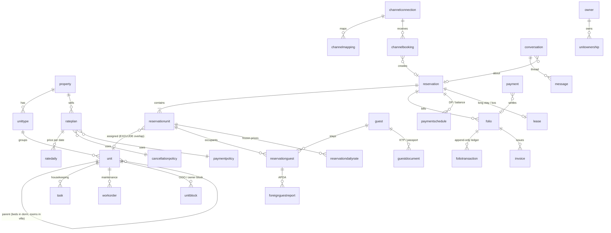

# Hospitality Suite — Database Design (PostgreSQL)

> **Status:** baseline for the next development phase · **Date:** 2026-11-08
> **Files in this folder**
> - `schema-control-plane.sql` — control-plane database (15 tables + seed data)
> - `schema-tenant.sql` — tenant database (128 tables, triggers, row-level security)
> - `database-design.md` — this document
>
> **Source requirements:** `reading/hospitality/*-functional-requirements.md`, `hospitality-suite-portfolio-architecture.md`, `indonesia-market-entry-strategy.md` (repo root).
> **Verified:** both files apply cleanly on PostgreSQL 16 together (single-DB dev mode). Behaviour tests passed for RLS isolation, fail-closed without a tenant, cross-tenant FK rejection, double-booking exclusion, back-to-back stays, append-only ledger, issued-invoice immutability and `SET NULL (col)` keeping `tenant_id`.

---

## 1. Multi-Tenancy Architecture

### 1.1 Two kinds of database

| Database | Count | Holds | Never holds |
|---|---|---|---|
| **Control plane** | 1 per deployment | Tenants, where each tenant's data lives, plans/entitlements, platform users (auth prefab `user`) ↔ tenant memberships, custom domains, property directory, usage roll-ups, channel and module catalogs | Guests, reservations, money |
| **Tenant DB** | 1..N | All operational data for one or many tenants | Login credentials |

```
                ┌───────────────────────── CONTROL PLANE DB ─────────────────────────┐
  login ──────► │ user (auth prefab) ─< tenantmembership >─ tenant ─ tenantdatabase  │
                │                                         │          │ (cluster,     │
                │                     tenantentitlement ──┘          │  db, schema,  │
                │                     tenantdomain, propertydirectory│  mode)        │
                └────────────────────────────────────────────────────┼───────────────┘
                                                                     │ routing
             ┌───────────────────────────────┬───────────────────────┴───────────────┐
             ▼                               ▼                                       ▼
   ┌───────────────────┐         ┌───────────────────────┐              ┌──────────────────────┐
   │ POOLED tenant DB  │         │ DEDICATED SCHEMA      │              │ DEDICATED DB         │
   │ tenants A,B,C…    │         │ server X / schema t_D │              │ server Y / db t_E    │
   │ RLS on tenant_id  │         │ RLS on (defence)      │              │ RLS on (defence)     │
   └───────────────────┘         └───────────────────────┘              └──────────────────────┘
          identical schema-tenant.sql in all three
```

### 1.2 Isolation modes (`tenantdatabase.isolation_mode`)

| Mode | When | How isolation works |
|---|---|---|
| `pooled_rls` (default) | Small/medium properties, trial, MVP | Many tenants share one DB. Every table has `tenant_id`; RLS policy `tenant_id = current_setting('app.tenant_id')`; composite FKs stop cross-tenant references |
| `dedicated_schema` | Mid-size tenants wanting separation without a new server | Same DDL in a schema per tenant; `search_path` set per connection |
| `dedicated_db` | Chains, data-residency demands, noisy neighbours, enterprise contracts | Own database (optionally own cluster/region). Same DDL; RLS still on |

**Why `tenant_id` stays on every table even in dedicated modes:** a tenant can move between modes by copying rows `WHERE tenant_id = :t`. All keys are UUIDs, so they never collide or need rewriting. The same code path and the same RLS safety net apply everywhere.

### 1.3 Request flow

1. User signs in (auth prefab) → JWT carries `user_id`.
2. The API resolves the active tenant from the subdomain or custom domain (`tenantdomain`), or from the user's choice. It checks `tenantmembership` and loads `tenantdatabase` (cached).
3. The API takes a connection from the pool for that cluster/database. For `dedicated_schema` it sets `search_path`.
4. Each transaction starts with `SET LOCAL app.tenant_id = '<uuid>'`. With no setting, **no rows are visible or writable** (fail closed).
5. Module access is checked against `tenantentitlement` (cached into `tenantprofile.enabled_modules` in the tenant DB).

### 1.4 Database roles

| Role | Rights | Used by |
|---|---|---|
| `app_rw` | DML on tenant tables, subject to RLS (not owner, no BYPASSRLS) | API |
| `app_ro` | SELECT, subject to RLS | Reporting/BI on replicas |
| `migrator` | Owner + BYPASSRLS | Alembic, tenant moves, cross-tenant jobs |
| `platform` | DML on control-plane tables | Provisioning/admin service |

Superusers bypass RLS. Never let the API connect as `postgres`.

### 1.5 Provisioning and moving a tenant

| Step | Pooled | Dedicated |
|---|---|---|
| 1 | Insert `tenant`, `tenantdatabase(status='provisioning')` | Same |
| 2 | Pick pooled cluster with capacity | `CREATE DATABASE` / `CREATE SCHEMA`, run migrations to head |
| 3 | In tenant DB insert `tenantprofile`, seed channels (from `channelcatalog`), default staff roles, transaction codes, tax pack, templates | Same |
| 4 | `status='ready'`, record `schema_version` | Same |

**Move pooled → dedicated:** set `status='moving'` (writes paused or read-only) → copy every table `WHERE tenant_id=:t` in FK order → verify row counts and checksums → switch `tenantdatabase` → delete source rows → log in `tenantmigration`.

### 1.6 Schema migrations across many databases

- One Alembic history for the tenant schema, one for the control plane.
- A migration runner iterates `tenantdatabase` rows (`status='ready'`), runs `alembic upgrade head` per database/schema, and records `schema_version`. Pooled DBs migrate once for all their tenants.
- Migrations must be backward compatible for one release (expand → migrate → contract), because databases upgrade at different times.

---

## 2. Domain Map



---

## 3. Conventions (apply to every new table)

| Rule | Detail |
|---|---|
| **Table name** | Lowercased SQLModel class name, no underscores (`RatePlan` → `rateplan`), per `instructions/backend.md` (no `__tablename__` override) |
| **Primary key** | `id uuid DEFAULT gen_random_uuid()`. The app may generate UUIDv7 for index locality |
| **Tenant key** | `tenant_id uuid NOT NULL` on every tenant table, plus `UNIQUE (tenant_id, id)` |
| **Foreign keys** | Composite: `(tenant_id, x_id) REFERENCES x (tenant_id, id)`, so the DB rejects cross-tenant links. Nullable FKs use `ON DELETE SET NULL (x_id)` (PG15+), which never nulls `tenant_id` |
| **Join tables** | Composite PK including `tenant_id`, no audit columns |
| **Audit columns** | `created_at`, `updated_at` (timestamptz, trigger-maintained), `created_by`, `updated_by` (text), the same as `TimestampMixin` |
| **Enumerations** | `text` + `CHECK (... IN (...))`, not PG enums (cheap to evolve) |
| **Money** | `numeric(18,2)` + `currency char(3)`. Default IDR. Never float |
| **Time** | Stay/business dates are `date` in property local time. Instants are `timestamptz`. Unit occupancy is `tstzrange` |
| **Multilingual content** | `jsonb` keyed by locale: `{"id-ID": {...}, "en": {...}}` |
| **Secrets** | Never stored. Columns end in `_secret_ref` (secret-manager key). Tokens are stored as hashes; card data as gateway tokens only |
| **PII** | Identity numbers encrypted in the app (`doc_number_encrypted`), plus an HMAC for lookup and the last 4 digits for display |
| **Optimistic locking** | `version integer` on reservation, reservationunit, folio, payment, inventoryday |
| **Control-plane references** | Plain integer/uuid columns (`user_id`, `portal_user_id`); no cross-DB FK |

### 3.1 Mapping to the existing SQLModel scaffold

The scaffold's `BaseEntity` uses an integer `id` and has no `tenant_id`. The next phase should add a sibling base in `backend/app/crud/base_model.py`:

```python
class TenantEntity(TimestampMixin, SQLModel):
    id: uuid.UUID = Field(default_factory=uuid.uuid4, primary_key=True)  # or uuid7
    tenant_id: uuid.UUID = Field(nullable=False, index=True)
```

- Declare `UniqueConstraint("tenant_id", "id")` and the composite `ForeignKeyConstraint`s in `__table_args__`. For example, `ForeignKeyConstraint(["tenant_id","property_id"], ["property.tenant_id","property.id"])`.
- A session dependency issues `SET LOCAL app.tenant_id` and picks the engine from `tenantdatabase`. `create_crud_router` then needs a tenant-aware `get_session`.
- Generated columns (`occupancy`, `available`, `variance`, `content_tsv`) use `sa_column=Column(..., Computed(...))`. Exclusion constraints, triggers and RLS are added in hand-written Alembic `op.execute()` blocks copied from `schema-tenant.sql`.
- Prefab tables stay where they are. `user`, `role`, `permission`, `user_roles`, `role_permissions` belong to the control plane (platform admins). Tenant staff permissions use `staffrole` / `staffrolepermission`, which reuse the permission **codes** from `backend/docs/rbac-spec.yaml`.
- The `uploadedfile` (upload prefab) and `audit_entries` (audit prefab) tables have no tenant scope. Tenant data uses `document` and `tenantauditentry` instead. Adapt the prefab services to write there.

---

## 4. Key Mechanisms

| Concern | Mechanism | Tables |
|---|---|---|
| **No double booking of a unit** | `EXCLUDE USING gist (unit_id WITH =, occupancy WITH &&)` on active statuses. `occupancy = [start_at, blocked_until)`, where `blocked_until = end_at + turnaround`, so hourly/day-use buffers work too | `reservationunit` |
| **Inventory counts / overselling** | One `inventoryday` row per unit type per date, locked `FOR UPDATE` during booking. `available` is a generated column. Channel overbookings are accepted and flagged by the app (no hard CHECK) | `inventoryday` |
| **Beds vs whole room, rooms vs whole villa** | `unit.parent_unit_id`. The app must check parent and children (the DB guards only the same `unit_id`) | `unit` |
| **OOO / owner blocks** | Non-overlapping per unit (`EXCLUDE`). `out_of_order` reduces `inventoryday.out_of_order` | `unitblock` |
| **Price frozen at booking** | `reservationdailyrate` stores per-night amounts; the policy snapshot is JSON on `reservation` | `reservationdailyrate`, `reservation` |
| **Ledger integrity** | `foliotransaction` is append-only (UPDATE/DELETE triggers). Voids and adjustments are new rows with `reverses_transaction_id`. Tax lines link to their charge with `parent_transaction_id` | `foliotransaction` |
| **Night-audit idempotency** | Unique index: one room charge per `reservation_daily_rate_id` | `foliotransaction` |
| **Gapless invoice numbers** | Lock the `documentsequence` row `FOR UPDATE` and increment it in the same transaction as the issue | `documentsequence`, `invoice` |
| **Issued invoices immutable** | Trigger allows only the PDF, fiscal ref and paid amount to change; corrections use credit notes | `invoice` |
| **Closed business days** | Trigger blocks reopening | `businessday` |
| **Payment idempotency** | `UNIQUE (tenant_id, idempotency_key)`; gateway webhooks are unique by `gateway_event_id` | `payment`, `paymentevent` |
| **Channel idempotency** | `UNIQUE (connection, external_booking_id, external_version)`; reservations unique by `(channel_id, channel_reference)` | `channelbooking`, `reservation` |
| **Event-driven modules** | Transactional outbox written with each business change, relayed to CRM, channel manager, RMS and the control-plane directory | `outboxevent` |
| **Tax (Indonesia)** | `taxrule` with `report_category` (PBJT hotel/restaurant, service charge), `region_code` (kab/kota), effective dating and `compound_order` (service charge before PBJT). `property.price_display_mode` handles nett vs "++" | `taxrule`, `transactioncodetax`, `taxreturn` |
| **APOA reporting** | One `foreignguestreport` per foreign occupant with a due time and submission log | `foreignguestreport` |
| **Transfer-proof flow** | Screenshot → `document` → AI extraction → `transferproof` match against `bankstatementline` / `payment` | `transferproof`, `bankstatementline` |
| **AI cost control** | Per-call `aiusage`, monthly `aibudget`, per-feature autonomy in `aifeaturesetting`. Every output is logged in `aisuggestion` | AI tables |

---

## 5. Entity Catalogue

**Phase** follows the suite build order: **1** = PMS Core + Payments + Booking Engine (+ Indonesia wedge), **2** = Channel Manager + Operations, **3** = CRM + AI v1, **4** = RMS / POS / Owner / Long stay, **5** = Enterprise.

### 5.1 Control plane (`schema-control-plane.sql`)

| Table | Purpose | Phase |
|---|---|---|
| `user` | *(auth prefab, existing)* login identity | 1 |
| `tenant` | Customer organisation, status, residency region, defaults | 1 |
| `dbcluster` | PostgreSQL servers available for tenant data | 1 |
| `tenantdatabase` | Routing: cluster / database / schema / isolation mode / schema version | 1 |
| `tenantmigration` | Schema upgrades and tenant moves history | 1 |
| `tenantmembership` | User ↔ tenant link (a user may belong to several tenants) | 1 |
| `tenantinvitation` | Pending staff invitations (hashed token) | 1 |
| `tenantdomain` | Custom hostnames for booking engine and portal → tenant | 1 |
| `propertydirectory` | Light cross-tenant property index for routing/search | 2 |
| `module` | Product modules catalog (seeded) | 1 |
| `plan`, `planmodule` | Subscription plans and the modules and limits they include | 1 |
| `tenantsubscription` | Tenant's plan over time | 1 |
| `tenantentitlement` | Effective module switches and limits per tenant | 1 |
| `channelcatalog` | Connectable channels (Traveloka, tiket.com, Agoda, Booking.com, Airbnb, Google, iCal …) (seeded) | 1 |
| `tenantusagemonthly` | Metered usage roll-up (AI cost, WhatsApp messages, units) | 3 |

### 5.2 Tenant database (`schema-tenant.sql`)

| Domain | Table | Purpose | Phase |
|---|---|---|---|
| **A. Organisation** | `tenantprofile` | Local mirror of tenant (FK anchor, cached modules) | 1 |
| | `legalentity` | Invoicing entity (NPWP, NIB, PKP) | 1 |
| | `property` | Property of any type; timezone, business date, tax region, check-in rules, syariah flag | 1 |
| | `propertyarea` | Buildings / floors / zones / campsite sites (tree) | 1 |
| | `amenity` | Amenity dictionary | 1 |
| | `document` | File metadata for scans, contracts, PDFs, photos (object storage key) | 1 |
| | `channel` | Booking sources and distribution channels (seeded from catalog) | 1 |
| | `marketsegment`, `reasoncode` | Code tables | 1 |
| **B. Staff** | `vendor` | External cleaners, technicians, laundry | 2 |
| | `staffmember` | Tenant staff profile (links to control-plane user; PIN for shared devices; UI mode classic/guided) | 1 |
| | `staffrole`, `staffrolepermission`, `staffroleassignment` | Tenant-scoped RBAC with optional per-property scope | 1 |
| **C. Inventory** | `unittype` | Category (room, bed, villa, pitch …), time grain (night/day/hour/month), occupancy | 1 |
| | `unit` | Assignable unit; parent/child for dorm beds and villa rooms; HK / FO / service status | 1 |
| | `inventoryitem` | Countable extras (parking, cots, lockers, bikes) | 1 |
| | `inventoryday` | Availability counters per unit type per date | 1 |
| **D. Finance config** | `taxrule` | PBJT, service charge, tourist tax, VAT; effective-dated; per region | 1 |
| | `transactioncode`, `transactioncodetax` | Posting codes → department, GL, taxes | 1 |
| | `exchangerate` | FX for display and owner reporting | 1 |
| **E. Rates** | `cancellationpolicy`, `paymentpolicy` | Rules (incl. DP schedules) | 1 |
| | `product` | Extras, fees, services, package components | 1 |
| | `rateplan` | Rate plans incl. derived rates, meal plan, nett/++ | 1 |
| | `rateplanunittype`, `rateplanproduct` | Applicability and package inclusions | 1 |
| | `ratedaily` | Price per plan × unit type × date (occupancy prices) | 1 |
| | `restriction` | Stop-sell, CTA/CTD, min/max stay, advance, scoped by type/plan/channel | 1 |
| | `promotion` | Promo codes | 1 |
| **F. Guests** | `account` | Company / agent / OTA / government accounts (AR) | 1 |
| | `guest` | Guest profile (single-name friendly), stats, merge, anonymisation | 1 |
| | `guestdocument` | KTP / passport / KITAS / marriage certificate (encrypted number) | 1 |
| | `guestpreference`, `guestconsent` | Preferences; consent per purpose and channel (PDP Law) | 1 |
| **G. Reservations** | `groupblock`, `groupblockday` | Group/allotment blocks and per-day pickup | 2 |
| | `reservation` | Booking header: status, channel, totals, policy snapshots | 1 |
| | `reservationunit` | Per-unit line with occupancy range and the no-double-booking constraint | 1 |
| | `reservationguest` | Occupants | 1 |
| | `reservationdailyrate` | Frozen nightly prices | 1 |
| | `reservationproduct` | Booked extras | 1 |
| | `reservationtrace`, `reservationchange` | Notes/alerts/traces; field-level history | 1 |
| **H. Billing** | `folio` | Guest / master / house / passer-by / AR / deposit folios | 1 |
| | `routinginstruction` | Charge routing to other folios | 1 |
| | `cashiershift` | Cash drawer per user/shift | 1 |
| | `foliotransaction` | Append-only ledger | 1 |
| | `documentsequence` | Gapless numbering | 1 |
| | `invoice`, `invoiceline` | Invoices, credit notes, receipts | 1 |
| | `paymentallocation` | AR: payments → invoices | 1 |
| | `businessday` | Night audit / end of day | 1 |
| **I. Payments** | `paymentgatewayaccount` | Midtrans / Xendit / DOKU / … config (secret refs) | 1 |
| | `paymentinstrument` | Tokens, OTA virtual cards | 1 |
| | `paymentlink` | WhatsApp-shareable pay links | 1 |
| | `paymentschedule` | DP / balance / instalments | 1 |
| | `payment` | QRIS, VA, e-wallet, card, cash, transfer, refunds | 1 |
| | `paymentevent` | Gateway webhooks (append-only) | 1 |
| | `bankstatementline`, `transferproof` | Manual transfer verification ("bukti transfer") | 1 |
| | `settlement`, `settlementline`, `chargeback` | Reconciliation and disputes | 2 |
| **J. Front desk** | `accesscredential` | Key cards, PIN codes, mobile keys (time-bound) | 2 |
| | `lostfounditem` | Lost & found | 2 |
| **K. Distribution** | `channelconnection` | Property ↔ channel link, status, payment model | 2 |
| | `channelmapping` | Unit type / rate plan → channel room/rate ids, allocation caps | 2 |
| | `channelbooking` | Inbound OTA booking envelopes (idempotent) | 2 |
| | `channelmessage` | ARI push / ack / error log | 2 |
| | `icalfeed` | iCal import/export per unit | 2 |
| | `channelperformancedaily` | Google/OTA impressions, clicks, bookings, cost | 2 |
| **L. CRM** | `messagingaccount` | WhatsApp / SMS / email / Instagram / Google Business senders | 3 (WhatsApp in 1 for Indonesia wedge) |
| | `messagetemplate` | Multilingual templates incl. WhatsApp approval status | 3 (1) |
| | `conversation`, `message` | Unified inbox | 3 (1) |
| | `guestsegment`, `campaign` | Segments and campaigns | 3 |
| | `automation`, `scheduledmessage` | Lifecycle journeys with review-before-send | 3 |
| | `review`, `surveyresponse`, `guestfeedback` | Reputation, surveys, complaints | 3 |
| **M. Operations** | `tasktemplate`, `task` | Housekeeping tasks and checklists | 2 |
| | `unitstatuslog` | Unit status history | 2 |
| | `asset`, `workorder`, `preventiveschedule` | Maintenance | 2 |
| **N. Owners** | `owner`, `unitownership`, `managementagreement` | Owners, shares, agreements | 4 |
| | `unitblock` | OOO / OOS / owner blocks / house use | 1 |
| | `ownerstatement`, `ownerstatementline`, `ownerpayout` | Owner accounting | 4 |
| **O. Long stay** | `lease`, `billingperiod`, `recurringcharge` | Kos / serviced-apartment leases and recurring billing | 4 (`recurringcharge` 1) |
| | `meter`, `meterreading` | Electricity / PLN token / water | 4 |
| **P. Compliance** | `foreignguestreport` | APOA foreign-guest reports | 1 |
| | `taxreturn` | PBJT and other periodic returns | 1 |
| | `datasubjectrequest` | PDP/GDPR requests | 1 |
| **Q. Ancillary** | `outlet`, `posorder`, `posorderline`, `servicebooking`, `voucher` | POS Lite, services, gift vouchers | 4 |
| **R. Revenue** | `demandevent` | Holidays, cuti bersama, Lebaran, local events | 4 |
| | `competitor`, `competitorrate` | Competitor set and shopped rates | 4 |
| | `forecastday`, `pricerecommendation`, `budget` | Explainable forecasts, recommendations, budgets | 4 |
| **S. AI** | `aifeaturesetting`, `aibudget` | Enablement, autonomy, monthly cap | 3 |
| | `aiknowledgeitem`, `aichunk` | Grounding knowledge base (full-text now; pgvector later) | 3 |
| | `aisuggestion`, `aiusage` | Every AI output and its cost | 3 |
| **T. Plumbing** | `outboxevent`, `webhookendpoint`, `webhookdelivery` | Events and outbound webhooks | 1 |
| | `apiclient`, `idempotencyrecord` | API keys; request idempotency | 1 |
| | `tenantauditentry` | Tenant-scoped hash-chained audit trail | 1 |

**CRS / multi-property:** a chain is one tenant with many `property` rows, so cross-property availability and reporting run inside one tenant DB with no extra tables. A management company that runs several *owner companies* is either one tenant with several `legalentity` rows, or several tenants with a shared user via `tenantmembership`.

---

## 6. Scale Notes (not needed for MVP)

| Table(s) | When it grows | Plan |
|---|---|---|
| `channelmessage`, `message`, `aiusage`, `outboxevent`, `tenantauditentry`, `foliotransaction` | Millions of rows | Range-partition by month on the time column. A partitioned table's unique keys must include the partition key, so FKs pointing *into* it break. `channelmessage`, `aiusage` and `tenantauditentry` are leaf tables and can be partitioned directly. `message` (referenced by `scheduledmessage`), `outboxevent` (by `webhookdelivery`) and `foliotransaction` (by `invoiceline`, `meterreading`, `servicebooking`) need those FKs dropped or re-keyed first, or archive closed periods instead |
| `ratedaily`, `restriction`, `inventoryday` | 365 days × unit types × plans | Fine with the unique indexes. Purge past dates beyond 2 years into history |
| Pooled DB size | Hundreds of tenants | Add pooled clusters and assign new tenants by capacity (`dbcluster.max_tenants`). Move large tenants to dedicated |
| Horizontal sharding | Thousands of tenants | Schema is Citus-compatible in spirit (tenant_id everywhere, composite keys). Switching PKs to `(tenant_id, id)` would be the main change |

---

## 7. Decisions for the Next Phase

| # | Decision | Recommendation |
|---|---|---|
| D1 | UUID v4 (DB default) vs v7 (app-generated) | v7 from the app for index locality; keep the DB default as fallback |
| D2 | Introduce `TenantEntity` base and tenant-aware session | Required before the first domain entity is built |
| D3 | Where control-plane tables live in dev | Same `prefab_db` (files designed to coexist); split when the second tenant DB is created |
| D4 | Encryption of identity numbers | App-level envelope encryption with KMS; HMAC key separate from the encryption key |
| D5 | pgvector for `aichunk.embedding` | Install when the AI v1 retrieval quality needs it; start with the `tsvector` index already in place |
| D6 | Migrations | Port the SQL files into two Alembic histories (control plane, tenant), with RLS/EXCLUDE/trigger blocks as `op.execute()` |
| D7 | Data residency | Pooled cluster in the Jakarta region by default (`tenant.data_region = 'ap-southeast-3'`) |
